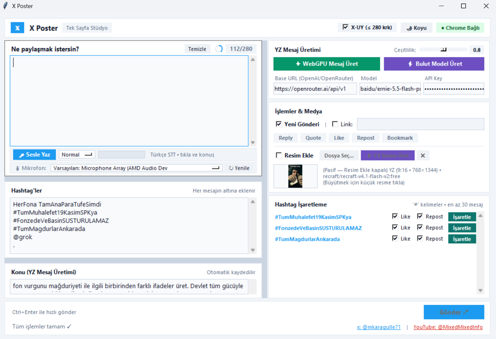

# X-MesajAtma (X Poster)

Kendi X (`x.com`) hesabınıza mevcut tarayıcınızı bozmadan ayrı bir Chrome profiliyle paylaşım yapan, yerel Türkçe sesle yazma (**STT**), yerel **WebGPU** / **Bulut YZ** metin üretimi, **YZ afiş/resim üretimi**, toplu hashtag beğeni/repost ve canlı sayaç takibi sunan Windows masaüstü uygulaması.



---

## Uygulamanın Özellikleri

1. Uygulama, ayrı bir Chrome profili kullanarak mevcut tarayıcınızı etkilemeden X hesabınıza tek pencereden paylaşım yapar.
2. İlk açılışta X hesabınıza bir kez giriş yapmanız yeterlidir ve oturumunuz sonraki açılışlarda da korunur.
3. Mesaj kutusuna yazdığınız metni `Gönder` butonuyla ya da `Ctrl+Enter` kısayoluyla anında paylaşabilirsiniz.
4. `Hashtag'ler` alanına yazdığınız etiketler her mesajınızın altına otomatik olarak eklenir ve dosyaya kaydedilir.
5. `X-UY` seçeneği açıksa yapay zeka mesajları 280 karakter sınırına göre, kapalıysa uzun gönderi modunda üretilir.
6. Tarayıcıdan tamamen bağımsız `Sesle Yaz` özelliği, Türkçe konuşmanızı yerel GPU veya CPU kullanarak kutuya canlı yazar.
7. Ekrandaki sabit mikrofon menüsünden istediğiniz mikrofonu seçebilir ve dinleme sırasında bile değiştirebilirsiniz.
8. Canlı ses çubuğu ve hassasiyet ayarı (`Sessiz`, `Normal`, `Gürültülü`) mikrofon sesinin algılanmasını kolaylaştırır.
9. `Konu` alanına yazdığınız başlığa göre Chrome içi WebGPU modeliyle veya bulut yapay zeka servisleriyle Türkçe mesaj üretebilirsiniz.
10. Çeşitlilik kaydıracı, yapay zekanın üreteceği mesajların yaratıcılık ve ton farklılığını ayarlar.
11. İstediğiniz bir X gönderisinin linkine `Reply`, `Quote`, `Like`, `Repost` ve `Bookmark` işlemlerini seçerek uygulayabilirsiniz.
12. `Resim Ekle` bölümünden bilgisayarınızdan görsel seçebilir ya da OpenRouter API anahtarıyla mesajınıza uygun görsel üretebilirsiniz.
13. Hashtag İşaretleme özelliği, seçtiğiniz etiket altındaki en az 30 gönderiyi otomatik olarak beğenir veya repost eder.
14. Uygulama, Açık ve Koyu tema seçenekli, bölmeleri sürüklenip ayarlanabilen tek sayfa arayüz sunar ve ayarlarınızı hatırlar.
15. Atılan mesaj, üretilen yapay zeka metni ve üretilen resim sayıları CounterAPI'ye canlı işlenir ve erişim kesilirse ilk bağlantıda tamamlanır.

---

## Kurulum — Windows (Hiç Bilgisayar Bilgisi Gerekmez)

> Tüm kurulum dosyalarını paket **kendisi indirir ve kurar**; Python, Chrome veya ek ayar yapmanız gerekmez.

### Yöntem 1 — İndir ve Tıkla (En Kolay)

1. Bu sayfanın sağ üstündeki yeşil **`Code`** düğmesine basın → **`Download ZIP`** seçin.
2. İnen ZIP dosyasına **sağ tıklayın → Tümünü Ayıkla (Extract All)** deyip klasöre çıkarın.
3. Klasördeki **`KUR.bat`** dosyasına **çift tıklayın**. *(Windows güvenlik uyarısı çıkarsa `Ek bilgi` → `Yine de çalıştır` seçin.)*
4. Açılan siyah kurulum penceresi **her şeyi otomatik tamamlayana kadar bekleyin**:
   - Python 3.13 yoksa kendisi indirip kurar.
   - Google Chrome yoksa kendisi indirip kurar.
   - Tüm Python paketlerini izole `.venv` ortamına kurar.
   - NVIDIA ekran kartınız varsa GPU ses hızlandırma paketlerini otomatik ekler.
   - Yerel Türkçe sesle yazma (STT) yapay zeka modelini (~1.5 GB) otomatik indirir.
   - Masaüstünüze **`X-MesajAtma`** simgesini oluşturur.
5. Kurulum bitince bir tuşa basın; uygulama doğrudan açılır. Sonraki günlerde masaüstündeki **`X-MesajAtma`** simgesine çift tıklamanız yeterlidir.

### Yöntem 2 — Tek Komutla Kurulum (PowerShell)

Başlat menüsüne `PowerShell` yazıp açın, aşağıdaki tek satırı yapıştırıp **Enter**'a basın:

```powershell
irm https://raw.githubusercontent.com/karagullemazhar-cpu/X-MesajAtma/main/KUR.ps1 | iex
```

---

## İlk Kullanım ve Ön Notlar

1. **Tek Seferlik X Girişi:** Uygulama ilk açıldığında ayrı bir Chrome penceresi (`ChromeProfile/`) açar. Sağ üstte `● X Girişi Gerekli` yazıyorsa o Chrome penceresinden X hesabınıza giriş yapın; oturumunuz kalıcı saklanır.
2. **Mikrofon İzni:** `🎤 Sesle Yaz` butonuna ilk basışınızda uygulamanın kendi penceresi mikrofon izni ister. Windows Ayarları → Gizlilik → Mikrofon altında masaüstü uygulamalarına izin verilmiş olmalıdır.
3. **Resim Üretimi (`✦ YZ Resim Üret`) Gereksinimi:** Sağ paneldeki **Bulut Model** bölümündeki **`API Key`** kutusuna geçerli bir **OpenRouter API Key** girmeli, `Resim Ekle` kutusunu işaretlemeli ve mesaj kutusunu doldurmalısınız *(ücretsiz `recraft/recraft-v4.1-flash-v2:free` modelini kullanır)*.

---

## Detaylı Kılavuzlar

Hangi tuşun ne işe yaradığını, ne zaman çalışıp ne zaman çalışmadığını ve tüm ön ihtiyaçları ayrıntılı okumak için:

- 🇹🇷 **[Tam Kullanıcı Kılavuzu (Türkçe)](KULLANIM_KILAVUZU_TR.md)**
- 🇬🇧 **[Complete User Guide (English)](USER_GUIDE_EN.md)**
- 📋 **[Kısa Özellik Listesi](Ozellikler.md)**

---

## Lisans

[MIT](LICENSE)
